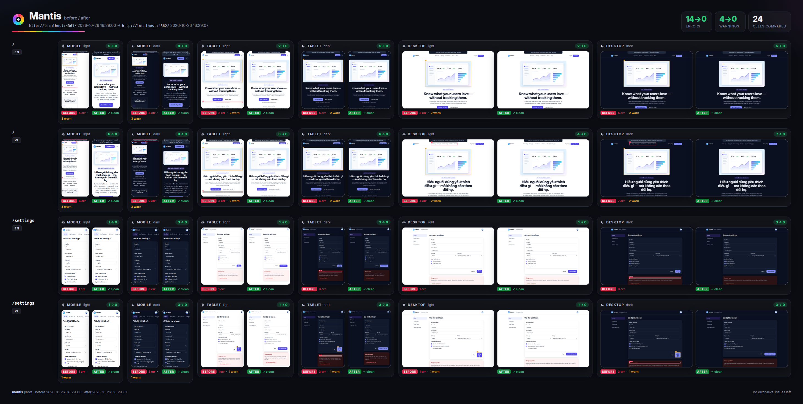

<p align="center">
  
</p>

<h1 align="center">Mantis</h1>

<p align="center">
  <em>Sees 12 color channels. You see 3. Your coding agent sees 0.</em>
</p>

<p align="center">
  <a href="https://github.com/vulinh1704/mantis/actions/workflows/ci.yml"></a>
  
  
  
  
</p>

---

Your coding agent builds UI with its eyes closed. It writes the CSS, says
**"Done ✅"**, and never opens the browser.

Then someone opens the page on a phone:
- the menu runs off the screen;
- in dark mode one card is still white, with white text on it;
- the Vietnamese button label is cut in half.

**Mantis gives the agent eyes.** It:
1. opens the real app;
2. checks every screen size, both themes and every language you ship;
3. boxes what is broken in red;
4. fixes it at the root;
5. proves it with before/after screenshots.

<p align="center">
  
</p>

## What it catches

| Problem | What you see | Why agents miss it |
|---|---|---|
| Page overflow | Sideways scrolling on a phone | They picture the desktop layout |
| Cut-off text | "Đăng ký nhận bản ti…" | They test with short English strings |
| Overlap | A badge sitting on top of a button | Absolute positioning looks fine at one width |
| Contrast | Gray text you can barely read | Colors are chosen in code, never seen |
| Dark-mode leaks | One white card in a dark page | A hard-coded `#fff` the theme can't reach |
| Tiny tap targets | 16px icon buttons on a phone | A mouse is precise, a thumb isn't |
| Console errors, broken images | Red errors, empty boxes | Nobody opened DevTools |
| Layout shift | Content jumps while you read | Everything loads instantly on localhost |

## How it works

1. **Look.** `/mantis` runs the app through every screen × theme × language in
   a real browser and writes a report the agent reads, with annotated
   screenshots.
2. **Fix.** `/mantis-fix` fixes causes, not symptoms. It never puts
   `overflow-x: hidden` on the body, shrinks text until it fits, or turns dark
   mode off, and the next run checks that it didn't.
3. **Prove.** `/mantis-proof` makes a before/after sheet, a close-up of one
   fixed finding, and optionally a video, for your pull request.

```bash
mantis look http://localhost:3000 --routes /,/settings --locales en,vi
```

<p align="center">
  
</p>

## Fixed, or just hidden?

An agent told to make the report clean can make it clean without fixing
anything. Every `mantis look` compares itself with the previous run of the same
URL, so these tricks don't work:

| Trick | What Mantis reports |
|---|---|
| `overflow-x: hidden` on `html`, `body` or the app root | The overflow, still: the element that is cut off, and the rule that hides it |
| Hide the broken element (`display: none`, `visibility: hidden`, `opacity: 0`) | `cover-up`: the issue is gone, but so is the element |
| Hide the *other* element of an overlap | `cover-up` on that element |
| Shrink the text until it fits | `cover-up`: 16px → 7px |
| Clip it, or cut the text short | `cover-up`: less of it is visible, or fewer characters |
| A button, link or heading quietly disappears | `lost` warning |

A cover-up is an error, so the run still fails. When the fix is honest, the run
ends with a receipt:

```
Mantis: 0 errors, 0 warnings in 24 cells
  vs 2026-10-29T11-51-22: 18 fixed · 0 new · 0 cover-ups · 0 lost
```

## Your project on the sheets

The contact sheet and the proof carry your project's name and a link and QR code
to its repo, read from `package.json` and the git remote. Add a `.mantis.json` to
change them:

```json
{ "name": "Lumen", "logo": "public/logo.svg", "brandColor": "#4f46e5", "repo": "acme/lumen", "qr": true }
```

## Pages behind a login

Give Mantis a Playwright storage state and every screen starts signed in:

```bash
npx playwright codegen --save-storage=.mantis/auth.json http://localhost:3000/login   # sign in, close the window
mantis look http://localhost:3000 --routes /dashboard,/settings --storage-state .mantis/auth.json
```

If the app only keeps a flag in localStorage (onboarding done, a demo session), write the file by hand:

```json
{ "cookies": [], "origins": [{ "origin": "http://localhost:3000", "localStorage": [{ "name": "onboarded", "value": "1" }] }] }
```

The file holds a live session, so keep it out of git (add `.mantis/` to your `.gitignore`). `proof --video` takes the same flag. A run is only compared with earlier runs that used a storage state file of the same name.

## Install

> Mantis is in early development (v0.2). Expect rough edges, and please [open an issue](https://github.com/vulinh1704/mantis/issues) when it gets something wrong.

**Claude Code**

```
/plugin marketplace add vulinh1704/mantis
/plugin install mantis@mantis
```

**Other agents.** The skills use the open `SKILL.md` format, so agents that load skills (Codex, Cursor, GitHub Copilot, Gemini CLI and others) can install them with:

```bash
npx skills add vulinh1704/mantis
```

**Just the CLI**

```bash
npx -y github:vulinh1704/mantis look http://localhost:3000
```

Mantis drives Chromium through Playwright. If the browser isn't installed yet, run `npx playwright install chromium`. Node.js 20 or newer.

## Numbers

What has been measured so far:

- **Planted bugs.** `fixtures/buggy-app` has 13 planted UI bugs, listed in
  [`PLANTED.json`](fixtures/buggy-app/PLANTED.json). Mantis reports every one
  of them in exactly the screen, theme and language cells where it was planted,
  and nothing else. On `fixtures/clean-app`, the same app with every bug fixed,
  it reports zero issues. Both checks run in CI.
- **Cover-ups.** Four tricks applied to `buggy-app` behind the same URL (hide
  the overflow with `overflow-x: hidden`, hide the menu button, hide the button
  it overlaps, shrink a label to 7px) are all still reported or flagged as
  cover-ups. Swapping in `clean-app`, the honest fix, gives every issue fixed,
  0 new, 0 cover-ups and 0 lost. This runs in CI too.
- **Cover-up false alarms.** Two runs in a row on tailwindcss.com, vercel.com,
  notion.com and stripe.com reported 0 cover-ups and 0 lost controls. On
  vnexpress.net, where the news changes between runs, they reported 0 cover-ups
  and one grouped "lost" warning. Checked on 2026-10-29.
- **Real sites.** On 10 public sites (example.com, playwright.dev, Hacker News,
  tailwindcss.com, MDN, svelte.dev, react.dev, gov.uk, vercel.com and
  stripe.com), 18 of the 21 errors it reported held up when checked by hand.
  The 3 false positives were demo frames on tailwindcss.com. Checked on
  2026-10-26.

Still to come is the agent benchmark: the same agent on the same tasks, with
and without Mantis, several runs each. We will publish the method, the tasks and
the misses, not only the wins.

## Limits

- Mantis checks that the page works, not that it is beautiful. Use it with a
  design skill.
- It doesn't click through flows or check hover and focus states yet.
- It doesn't measure animation smoothness yet.
- Cover-up checks need a previous run of the same URL to compare with. Layout
  shift, console and network issues change by themselves on live pages, so they
  are not checked for cover-ups.

## Why a mantis shrimp?

It has 12 kinds of color receptors; you have 3. It also throws one of the fastest
punches in the animal kingdom. It sees the bug, then it hits the bug.

## License

MIT © Truong Dang Vu Linh. Built on [Playwright](https://playwright.dev) and
[axe-core](https://github.com/dequelabs/axe-core).
