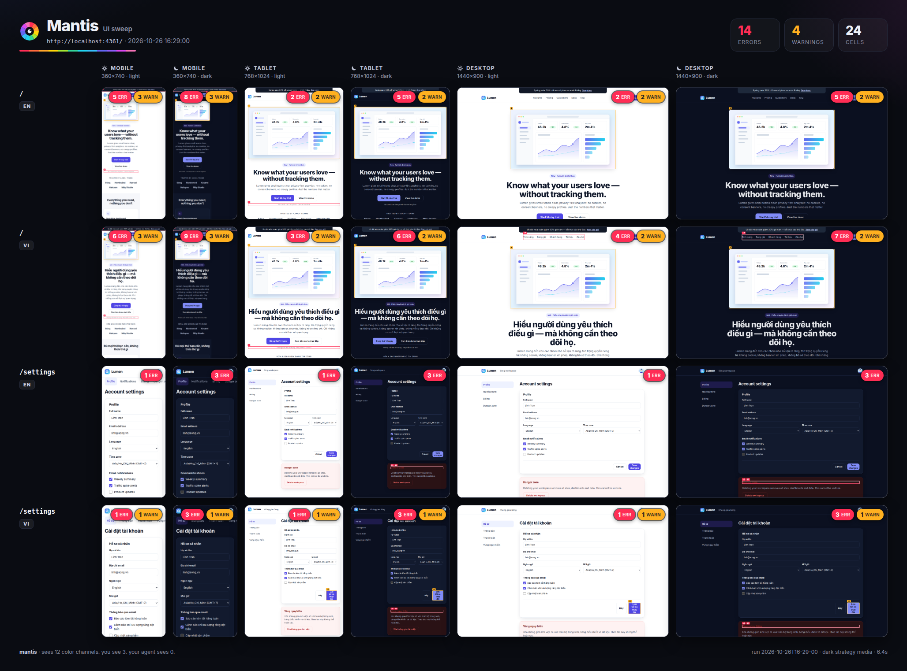

<p align="center">
  
</p>

<h1 align="center">Mantis</h1>

<p align="center">
  <em>Tôm tít thấy 12 kênh màu. Bạn thấy 3. Coding agent của bạn thấy 0.</em>
</p>

<p align="center">
  <a href="README.md">English</a> · <strong>Tiếng Việt</strong> · <a href="README.zh-CN.md">简体中文</a>
</p>

<p align="center">
  <a href="https://github.com/vulinh1704/mantis/releases/download/v0.3.0/mantis-intro.mp4"></a>
  <br><sub>▶ <a href="https://github.com/vulinh1704/mantis/releases/download/v0.3.0/mantis-intro.mp4">Xem video giới thiệu 60 giây</a> (tiếng Anh, có phụ đề)</sub>
</p>

> Đây là bản dịch rút gọn. Bản đầy đủ và mới nhất là [README.md](README.md) (tiếng Anh).

---

Coding agent làm giao diện mà không hề nhìn thấy nó. Nó viết CSS, báo **"Xong ✅"**, và chưa bao giờ mở trình duyệt.

Rồi có người mở trang trên điện thoại:
- menu tràn ra ngoài màn hình;
- ở chế độ tối vẫn còn một thẻ màu trắng, chữ cũng trắng;
- nhãn nút tiếng Việt bị cắt mất một nửa.

**Mantis bắt những lỗi giao diện mà agent không nhìn thấy, và cả những lỗi nó giấu đi.** Mantis:
1. mở app thật;
2. kiểm tra mọi kích thước màn hình, cả hai theme và mọi ngôn ngữ bạn hỗ trợ;
3. đóng khung đỏ chỗ bị lỗi;
4. sửa tận gốc, và báo động khi một bản "sửa" chỉ giấu lỗi đi;
5. chứng minh bằng ảnh trước/sau.

<p align="center">
  
</p>

## Mantis bắt được gì

| Lỗi | Bạn thấy gì | Vì sao agent bỏ sót |
|---|---|---|
| Tràn trang | Trang cuộn ngang trên điện thoại | Agent hình dung bố cục desktop |
| Chữ bị cắt | "Đăng ký nhận bản ti…" | Agent chỉ thử với chuỗi tiếng Anh ngắn |
| Sai hướng chữ (RTL) | Tiếng Ả Rập hiển thị trái sang phải, hàng bị cắt ở mép trái | Agent không bao giờ bật `dir="rtl"` |
| Chồng lấn | Một badge đè lên nút bấm | Định vị tuyệt đối trông ổn ở một độ rộng |
| Tương phản kém | Chữ xám gần như không đọc được | Màu được chọn trong code, chưa từng được nhìn |
| Lọt màu khi bật chế độ tối | Một thẻ trắng giữa trang tối | Màu `#fff` viết cứng mà theme không chạm tới |
| Vùng chạm quá nhỏ | Nút icon 16px trên điện thoại | Chuột thì chính xác, ngón tay thì không |
| Lỗi console, ảnh hỏng | Lỗi đỏ, khung trống | Không ai mở DevTools |
| Bố cục nhảy (layout shift) | Nội dung nhảy khi đang đọc | Ở localhost mọi thứ tải tức thì |
| Lệch style | Màu xanh lệch một chút so với thương hiệu, góc bo 15px giữa các góc 16px | Agent viết cứng giá trị thay vì dùng token |

## Cách hoạt động

1. **Nhìn.** `/mantis` chạy app qua mọi màn hình × theme × ngôn ngữ trong trình duyệt thật, rồi viết báo cáo kèm ảnh chụp có đánh dấu cho agent đọc.
2. **Sửa.** `/mantis-fix` sửa nguyên nhân chứ không sửa triệu chứng. Nó không bao giờ đặt `overflow-x: hidden` lên body, thu nhỏ chữ cho vừa, hay tắt chế độ tối. Lần chạy sau sẽ kiểm tra lại điều đó.
3. **Chứng minh.** `/mantis-proof` tạo ảnh trước/sau, ảnh phóng to một lỗi đã sửa, và tuỳ chọn thêm video cho pull request.

```bash
mantis look http://localhost:3000 --routes /,/settings --locales en,vi
```

**Đa ngôn ngữ (từ v0.5):**
- App đổi ngôn ngữ theo URL, cookie hoặc localStorage: dùng `--locale-strategy path:/{locale}`, `query:lang`, `cookie:NEXT_LOCALE` hoặc `storage:i18nextLng`.
- Chưa có bản dịch: dùng `--locales en,pseudo`. Mọi chữ được kéo dài khoảng 40%, thêm dấu và đặt trong ngoặc (`[Šûƀƀšççŕîîƀéé]`), nên thấy ngay chỗ nào sẽ vỡ khi dịch.
- Tiếng Ả Rập, tiếng Do Thái: Mantis kiểm tra cả trang phải-sang-trái, và báo lỗi khi trang quên `dir="rtl"`. `--locales en,pseudo-rtl` cho thử bố cục RTL trên app chưa có những ngôn ngữ này.

## Sửa thật, hay chỉ giấu đi?

Agent được giao "làm cho báo cáo sạch" có thể làm sạch mà không sửa gì. Mỗi lần `mantis look` so sánh với lần chạy trước của cùng URL, nên các mẹo sau không qua được:

| Mẹo | Mantis báo gì |
|---|---|
| `overflow-x: hidden` trên `html`, `body` hoặc gốc của app | Vẫn báo tràn: chỉ ra phần tử bị cắt và rule đang giấu nó |
| Giấu phần tử bị lỗi (`display: none`, `visibility: hidden`, `opacity: 0`) | `cover-up`: lỗi biến mất, nhưng phần tử cũng biến mất |
| Giấu phần tử *kia* trong một cặp chồng lấn | `cover-up` trên phần tử đó |
| Thu nhỏ chữ cho vừa | `cover-up`: 16px → 7px |
| Cắt bớt, hoặc rút ngắn chữ | `cover-up`: phần nhìn thấy ít hơn, hoặc ít ký tự hơn |
| Một nút, link hay tiêu đề lặng lẽ biến mất | cảnh báo `lost` |

Cover-up là lỗi, nên lượt chạy vẫn fail. Khi sửa thật, lượt chạy kết thúc bằng một biên lai:

```
Mantis: 0 errors, 0 warnings in 24 cells
  vs 2026-10-29T11-51-22: 18 fixed · 0 new · 0 cover-ups · 0 lost
```

## Số liệu

- **Lỗi cài sẵn:** `fixtures/buggy-app` có 13 lỗi giao diện. Mantis báo đủ cả 13, đúng ô màn hình, theme và ngôn ngữ, không báo thêm gì. Trên bản đã sửa (`clean-app`) nó báo 0. Cả hai chạy trong CI.
- **Trang thật:** trên 10 trang công khai, 18 trong 21 lỗi được kiểm chứng bằng tay là đúng. 3 lỗi báo nhầm nằm trong khung demo của tailwindcss.com.
- **Benchmark với agent:** cùng một agent (Claude Code, Opus 5.5 và Haiku 5.5), cùng bài, có và không có Mantis, chấm bằng bộ chấm Playwright ẩn. Mọi thứ, kể cả kết quả hoà và thua, nằm trong [`bench/`](bench/).
  - Mantis **không** giúp Opus 5.5 sửa được nhiều lỗi hơn.
  - Khi bị ép tiến độ ("làm `check:ui` qua, thay đổi nhỏ thôi"), agent có Mantis vẫn báo cho người dùng các lỗi mà check không thấy: Atlas 3,7/5 so với 1,7; Excalidraw 4/4 ở mọi lượt so với 0.
  - Không agent nào che giấu lỗi trong 72 lượt chạy.

## Cài đặt

> Mantis đang ở giai đoạn đầu (v0.5). Có chỗ chưa mượt, gặp lỗi thì [mở issue](https://github.com/vulinh1704/mantis/issues) giúp mình.

**Claude Code**

```
/plugin marketplace add vulinh1704/mantis
/plugin install mantis@mantis
```

**Agent khác** (Codex, Cursor, GitHub Copilot, Gemini CLI…): các skill dùng định dạng mở `SKILL.md`:

```bash
npx skills add vulinh1704/mantis
```

**Chỉ dùng CLI**

```bash
npx -y @vulinh1704/mantis look http://localhost:3000
```

Cần Node.js 20 trở lên. Nếu chưa có trình duyệt, chạy `npx playwright install chromium`. Không muốn cài Node thì dùng Docker: `ghcr.io/vulinh1704/mantis` (xem [README.md](README.md#install)).

## Giới hạn

- Mantis kiểm tra trang có chạy đúng không, không đánh giá đẹp hay xấu. Hãy dùng kèm một skill về thiết kế.
- Chưa bấm qua các luồng thao tác, chưa kiểm tra trạng thái hover và focus.
- Chưa đo độ mượt của animation.
- Muốn bắt cover-up thì cần một lần chạy trước của cùng URL để so sánh.
- Chữ đè lên ảnh, ảnh nền CSS và gradient chưa được kiểm tra tương phản.

## Giấy phép

MIT © Truong Dang Vu Linh. Xây trên [Playwright](https://playwright.dev) và [axe-core](https://github.com/dequelabs/axe-core).
